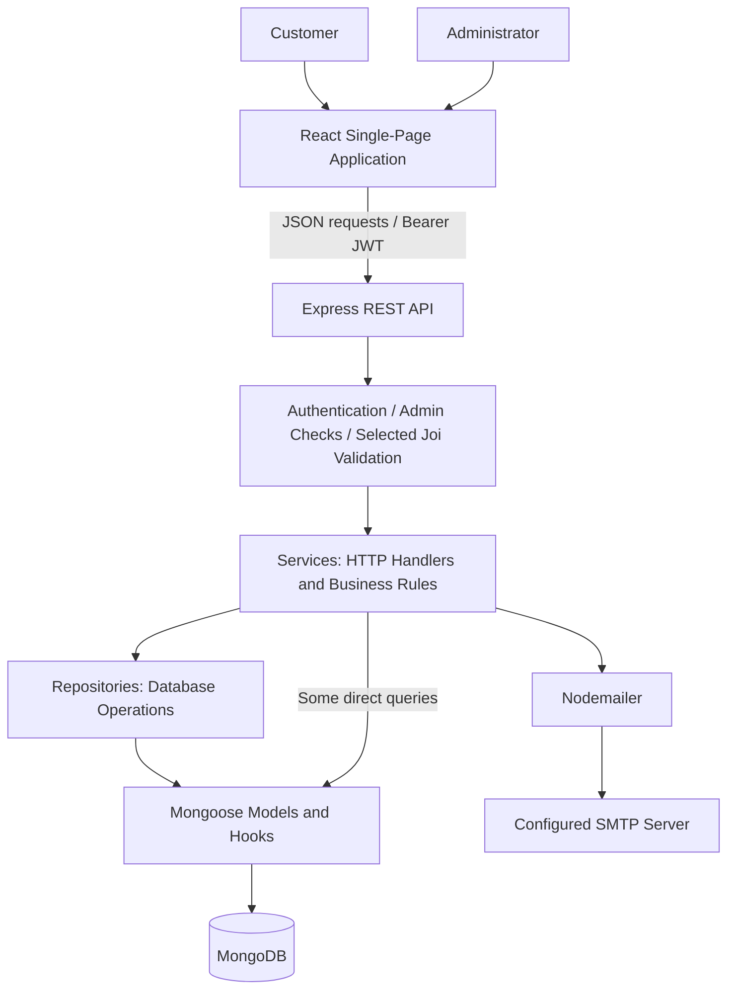
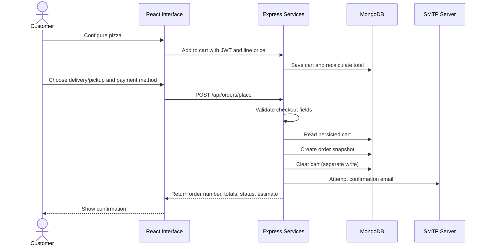
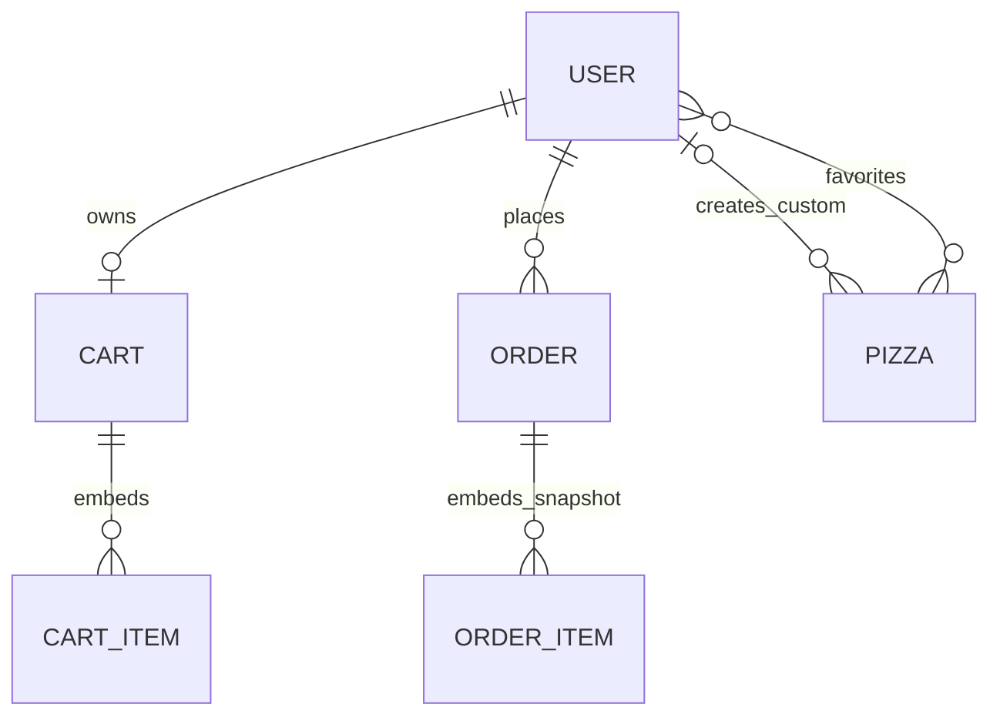

<div align="center">

# 🍕 Pizza Pete’s

### Full-Stack Pizza Ordering Platform

**Pizza Customization · Persistent Cart · Customer Accounts · Order Management · Restaurant Administration**

[](#technology-stack)
[](#technology-stack)
[](#architecture)
[](#database)
[](#installation-and-run)
[](#1-customer-accounts-and-authentication)

**One application connecting the customer’s pizza order with the restaurant’s daily management workflow.**

[Overview](#overview) ·
[Architecture](#architecture) ·
[Core Modules](#core-modules) ·
[Showcase](#platform-showcase) ·
[Installation](#installation-and-run) ·
[Verification](#verification) ·
[Technical Guide](docs/technical-guide.md)

</div>

---

# Overview

**Pizza Pete’s is a full-stack JavaScript application for configuring pizzas, placing orders, and managing restaurant operations through separate customer and administrator interfaces.**

The application connects six functional areas:

1. customer accounts and authentication;
2. menu discovery and favorites;
3. pizza customization and saved recipes;
4. persistent cart and checkout;
5. customer order management;
6. restaurant administration and email notifications.

Rather than stopping at a menu interface, the project follows data from a customer's selection through API validation, MongoDB persistence, order creation, and administrator status updates.

```text
Customer Account
      │
      ▼
Menu & Favorites
      │
      ▼
Pizza Configuration ──► Saved Custom Recipes
      │
      ▼
Persistent Cart
      │
      ▼
Delivery / Pickup Order
      │
      ├──► Customer Order History
      ├──► Administrator Status Updates
      └──► SMTP Email Notifications
```

> [!IMPORTANT]
> This is a development project, not a verified production commerce platform. Card payment is simulated. Public administrator registration and default-admin seeding require hardening before any public deployment.
>
> Showcase images come from the repository’s `front/public` directory. They illustrate application screens, not independently verified production operation or performance results.

---

# Problem and Purpose

A pizza-ordering workflow involves more than choosing an item from a menu:

- customers need configurable sizes, crusts, toppings, and quantities;
- carts must persist between page visits;
- checkout needs an order snapshot and delivery details;
- customers need access to their previous orders;
- restaurant staff need tools to maintain the menu and update fulfillment status.

Pizza Pete’s brings these concerns into one application, while keeping the browser interface, HTTP API, business rules, and persistence code identifiable in the repository.

**Intended audience:** developers exploring full-stack ordering workflows and maintainers extending a restaurant-focused application. The interface is primarily French, and customer-facing prices generally use Tunisian dinars (`DT`).

---

# Architecture



| Component | Responsibility |
|---|---|
| **React frontend** | Renders customer/admin pages, manages page state, and sends API requests. |
| **Express routers and middleware** | Map endpoints to handlers and enforce JWT/admin requirements. |
| **Services** | Handle requests, apply workflow checks, coordinate persistence, and produce JSON responses. |
| **Repositories** | Perform most queries, cart updates, pagination, and reference population. |
| **Mongoose models** | Define users, pizzas, carts, orders, indexes, validation, and save/update hooks. |
| **Email service** | Attempts order-confirmation and status-update messages through SMTP. |

The frontend and backend are installed and run separately. Express does not serve the frontend build. There is no centralized frontend API client: API-calling pages currently hardcode `http://localhost:5004`.

---

# Core Modules

## 1. Customer Accounts and Authentication

Customer registration stores identity and delivery information. Passwords are hashed with **bcryptjs**, and login returns a **JWT with a 30-day expiration**.

```text
Register / Login
      ↓
Validate Input and Verify Credentials
      ↓
Return JWT + User Profile
      ↓
Browser localStorage
      ↓
Authorization: Bearer <token>
      ↓
API Loads Current User and Checks Access
```

The browser uses cached authentication data for page redirects; the API checks the actual database user for protected requests. Customers can edit their profile and change passwords using their current password. Email verification, password reset, refresh tokens, and token revocation are not implemented.

**Source:** `back/src/service/authService.js`, `back/src/middleware/auth.js`, `back/src/config/jwt.js`, and `front/src/pages/Login.jsx`.

## 2. Menu Discovery and Favorites

Customers can browse available pizzas, search by name, filter categories, and maintain favorites tied to their account.

| Category | API value |
|---|---|
| Classic | `classic` |
| Special | `special` |
| Vegetarian | `vegetarian` |
| Spicy | `spicy` |
| Custom | `custom` |

Favorites are Pizza references stored on the User document. Public menu queries also include available custom pizzas; custom recipes are not a separate private catalog.

**Source:** `pizzaRepository.js`, `userRepository.js`, `Home.jsx`.

## 3. Pizza Customization and Saved Recipes

The home-page builder supports:

- **three sizes:** small, medium, large;
- **three crusts:** thin, pan, stuffed;
- additional toppings, with an eight-topping UI selection limit;
- quantities from one to ten;
- named custom recipes saved to the customer account.

```text
Base Pizza
    + Size Surcharge
    + Crust Surcharge
    + Selected Toppings
              ↓
       Multiply by Quantity
              ↓
        Submitted Line Price
```

Saved recipes use the same **Pizza model** as menu items, with `isCustom`, `createdBy`, `customConfig`, and a generated `customPizzaId`.

> The browser computes the price. The current cart API accepts that submitted price instead of reconstructing it from trusted catalog options. Server-side pricing is a required improvement before commercial use.

**Source:** `Home.jsx`, `MyCustomPizzas.jsx`, `pizzaService.js`, `model.js`.

## 4. Persistent Cart and Checkout

MongoDB stores one cart per user. Cart lines contain the chosen configuration, quantity, unit price, and expanded line price. Matching configurations can merge into an existing line.

Checkout reads the **persisted server-side cart** rather than trusting frontend-submitted order totals.

| Rule | Current implementation |
|---|---|
| Delivery fee | `3.500` when subtotal is **30 or less**; free above `30`. |
| Pickup | No delivery fee; an address is still required. |
| Tax | No tax added by checkout. |
| Cash | Initial payment status is `pending`. |
| Card | Marked `paid` without a payment-provider transaction. |
| Order creation | Save an order snapshot, then clear the cart in a separate write. |

**Source:** `cartService.js`, `cartRepository.js`, `orderService.js`, `Cart.jsx`.

## 5. Customer Order Management

Customers can retrieve paginated orders, filter/search the list, inspect details, reorder from the interface, and cancel eligible orders.

Supported status values:

```text
pending → confirmed → preparing → out_for_delivery → delivered
    
    └── cancelled
```

This is an illustrative fulfillment path, **not an enforced state machine**: administrators can currently choose any supported status. Customers cannot cancel orders that are already delivered, cancelled, or out for delivery.

The tracking API returns the stored status and an estimated time. It does not provide GPS tracking or a live courier integration.

**Source:** `orderService.js`, `orderRepository.js`, `Orders.jsx`.

## 6. Restaurant Administration and Notifications

Administrator pages cover:

- listing, editing, and deleting users;
- customer/admin counts;
- creating, editing, and deleting pizzas;
- reviewing orders and changing their status.

Nodemailer attempts confirmation and status-update emails. SMTP failures are caught and logged; they do not undo a persisted order. Email delivery is attempted inside the request rather than through a background job queue.

**Source:** `Admin.jsx`, `AdminPizzas.jsx`, `AdminOrders.jsx`, `adminService.js`, `adminOrderService.js`, `emailService.js`.

---

# Platform Showcase

The following images are selected from the screenshots supplied in `front/public`. Screens containing visible personal contact details are not embedded here. Displayed counts and amounts are capture-time data, not project evaluation metrics.

## Menu Categories and Favorites

<p align="center">
  
</p>

Category navigation and saved favorites keep frequently selected pizzas accessible from the customer interface.

---

## Pizza Configuration

<p align="center">
  
</p>

The configuration dialog exposes size and crust surcharges alongside additional toppings.

---

## Persistent Shopping Cart

<p align="center">
  
</p>

Customers can change quantities, remove items, inspect the delivery fee, and proceed to checkout.

> The screenshot contains payment-related UI labels. These labels do not establish payment security or a real payment integration; the card flow remains simulated.

---

## Restaurant Menu Management

<p align="center">
  
</p>

Administrators maintain menu data through dedicated forms. Image handling uses URLs; the repository does not implement a file-upload service.

---

# End-to-End Workflow



The confirmation page uses router state or cached `lastOrder` data and includes a demo fallback. Check `/orders` or the order API to confirm persistence rather than relying on the confirmation screen alone.

---

# Technology Stack

| Layer | Technologies | Purpose |
|---|---|---|
| Frontend | React 19, React DOM | Page rendering, local state, effects. |
| Navigation | React Router DOM 7 | Customer/admin routes and redirects. |
| HTTP | Axios, browser Fetch | JSON API requests. |
| Build tooling | Vite 7, React plugin | Development server and frontend production build. |
| Backend | Node.js, Express 4 | REST API and HTTP request handling. |
| Database | MongoDB, Mongoose 7 | Documents, references, validation, indexes, hooks. |
| Authentication | jsonwebtoken, bcryptjs | Bearer tokens and password hashing. |
| Validation | Joi | Authentication and checkout request schemas. |
| Notifications | Nodemailer | SMTP email attempts. |
| Configuration | dotenv, cors | Environment loading and cross-origin middleware. |
| Development checks | ESLint 9, nodemon | Frontend lint and backend reloads. |

Major versions reflect declared dependency ranges. Lockfiles pin the installed dependency trees; [the technical guide](docs/technical-guide.md#technology-stack) provides the detailed package reference.

---

# Repository Structure

```text
Full-Stack-Pizza-Ordering-Platform/
├── back/
│   ├── package.json             # start / dev scripts
│   ├── package-lock.json
│   └── src/
│       ├── main.js              # Express, MongoDB connection, automatic seed
│       ├── model.js             # User, Pizza, Cart, Order schemas and hooks
│       ├── schema.js            # Joi schemas and request validator
│       ├── config/              # JWT utilities and separate DB helper
│       ├── middleware/          # Authentication, admin checks, custom IDs
│       ├── router/              # HTTP route definitions
│       ├── service/             # Request handling, workflows, email templates
│       └── repository/          # Queries and persistence operations
├── front/
│   ├── package.json             # dev / build / lint / preview scripts
│   ├── package-lock.json
│   ├── vite.config.js           # React plugin; no API proxy
│   ├── public/                  # Supplied screenshots and public assets
│   └── src/
│       ├── main.jsx             # React entry point
│       ├── App.jsx              # BrowserRouter and access redirects
│       └── pages/               # Customer and administrator screens
├── docs/
│   └── technical-guide.md       # Detailed installation, API, data, caveats
└── README.md
```

There is no root-level package manifest. Install dependencies and run scripts separately inside `front/` and `back/`.

---

# Database



| Model | Stored information |
|---|---|
| **User** | Profile, address, unique email, password hash, admin flag, favorite references. |
| **Pizza** | Menu details, base price, category, ingredients, availability, custom-recipe fields. |
| **Cart** | User reference, embedded configured lines, unit/line prices, total. |
| **Order** | Customer reference, item snapshots, delivery details, totals, status, payment labels, tracking number, timestamps. |

Cart and order items are embedded subdocuments, not separate collections. Their mixed-type pizza IDs support ObjectIds and custom identifiers rather than one enforced reference scheme.

[Read model relationships, indexes, hooks, and data-lifecycle caveats →](docs/technical-guide.md#database-and-data-lifecycle)

---

# Installation and Run

## 1 / Install

**Requirements:** Node.js 22.12+ in the 22.x line, npm, Git, and a running MongoDB server. No MongoDB server version is pinned. SMTP is optional for actual email delivery.

```bash
git clone https://github.com/Achref-004/Full-Stack-Pizza-Ordering-Platform.git
cd Full-Stack-Pizza-Ordering-Platform

(cd back && npm ci)
(cd front && npm ci)
```

## 2 / Configure

Create **`back/.env`** using this safe template. Generate a random secret before using authentication.

```dotenv
MONGODB_URI=mongodb://127.0.0.1:27017/pizzapetes
PORT=5004
JWT_SECRET=replace_with_a_long_random_value

# Optional SMTP credentials; blank values do not disable send attempts.
SMTP_HOST=smtp.gmail.com
SMTP_PORT=587
SMTP_USER=
SMTP_PASS=
```

```bash
# Generate a secret locally; paste it into JWT_SECRET. Never commit it.
node -e "console.log(require('node:crypto').randomBytes(48).toString('hex'))"
```

> [!WARNING]
> Use an **isolated development database**. Startup inserts six pizzas if the Pizza collection is empty and creates a hardcoded default administrator if none exists. Credentials are in the seed code and printed by startup; they are not repeated here. There is no seed-disable flag.

## 3 / Run

Start **MongoDB first**, then launch the two applications in separate terminals, from the repository root:

| Terminal A — API | Terminal B — frontend |
| :--- | :--- |
| `cd back` | `cd front` |
| `npm run dev` | `npm run dev` |
| `http://localhost:5004` | Usually `http://localhost:5173` |

```bash
# Check the API, then open the frontend URL printed by Vite.
curl -i http://localhost:5004/
curl -i http://localhost:5004/api/pizzas
```

**Local-browser setup only:** frontend pages hardcode `http://localhost:5004`. No `VITE_API_URL` or API proxy is implemented. Remote previews and public hosting need configuration/code changes first. A root `200 OK` is not a database health check.

[Detailed installation](docs/technical-guide.md#installation-and-local-setup) · [Configuration reference](docs/technical-guide.md#configuration-reference) · [Troubleshooting](docs/technical-guide.md#troubleshooting)


---

# Usage and API Reference

### Customer journey

```text
/register → /login → /home → /cart → /confirmation → /orders
                         ├── /my-custom-pizzas
                         └── /profile
```

Use **cash** for local checkout exploration. Never enter real card information.

### Administrator journey

```text
Administrator login → /admin
                         ├── /admin/pizzas
                         └── /admin/orders
```

### Representative endpoints

| Method | Endpoint | Access / purpose |
|---|---|---|
| POST | `/api/auth/register` | Public customer registration. |
| POST | `/api/auth/login` | Return profile and JWT. |
| GET | `/api/pizzas` | Public list of available pizzas. |
| GET | `/api/user/profile` | Authenticated profile. |
| POST | `/api/cart/add` | Authenticated cart mutation. |
| POST | `/api/orders/place` | Create an order from the stored cart. |
| GET | `/api/orders/my-orders` | Customer orders with pagination/filtering. |
| GET | `/api/orders/:id` | Owner/admin order details. |
| PUT | `/api/admin/orders/:id/status` | Administrator status update. |

Protected requests use `Authorization: Bearer <token>`.

[Full endpoint tables](docs/technical-guide.md#rest-api-reference) · [Copyable API walkthrough](docs/technical-guide.md#example-register-authenticate-add-a-pizza-and-order) · [Troubleshooting](docs/technical-guide.md#troubleshooting)

---

# Verification

| Check | Observed result |
| :--- | :--- |
| Dependency installation | ✅ Both packages installed with `npm ci`. |
| Frontend production build | ✅ Succeeded; JavaScript chunk-size warning. |
| Backend syntax checks | ✅ All backend JavaScript files passed `node --check`. |
| Frontend lint | ⚠️ **23 errors / 10 warnings** remain. |
| Isolated API smoke checks | ✅ Root 200, protected cart 401, unknown path 404. |
| Database, checkout, SMTP | ➖ Not exercised against live MongoDB/SMTP. |
| Showcase images | Repository-provided screenshots; not a new end-to-end verification. |

<sub>Code checks performed on 2026-10-18 using Node.js 22.22.3 and npm 10.9.8. No automated test suite or `test` script is committed. Repository screenshots do not establish that all workflows are tested.</sub>

<details>
<summary><strong>Run the available checks</strong></summary>

```bash
(cd front && npm run build)
(cd front && npm run lint)
find back/src -name '*.js' -exec node --check {} \;
```

The frontend build outputs `front/dist/`. `npm run preview` from `front/` serves that build locally; it is not a production deployment process. The backend has `npm start` for a non-watching process. No validated hosting configuration or CI pipeline is supplied.

</details>

<details>
<summary><strong>Important limitations before extending or deploying</strong></summary>

- Public administrator registration, default credentials, and password-containing request logs require immediate hardening.
- Cart prices are client-supplied; card selection does not charge a provider.
- `/api/orders/history` and `/api/custom-pizzas/popular` are shadowed by earlier `/:id` routes. Use `/api/orders/my-orders` for the order list.
- The order update hook can regenerate tracking numbers and estimates when status changes.
- Available-only queries hide unavailable pizzas from shared admin listing/statistics; public listings also include available custom recipes.
- Checkout has no transaction/idempotency protection; user/pizza deletion does not cascade.
- Browser authentication uses localStorage; API URLs are duplicated and hardcoded.
- No real courier tracking, password-reset flow, inventory system, or verified production deployment is implemented.

See the [full limitations](docs/technical-guide.md#known-limitations-and-future-improvements) for reference handling, popularity counters, validation, and data-consistency details.

</details>

---


# Limitations

This project contains implemented workflows, but several boundaries matter when evaluating or extending it:

- **Admin provisioning:** public administrator registration and hardcoded default-admin creation must be restricted before external access. Signup/seed logs can expose passwords.
- **Payment:** no gateway transaction or refund mechanism exists; card selection immediately marks an order paid.
- **Pricing:** cart line prices are supplied by the browser, not recomputed from trusted server-side catalog rules.
- **Order consistency:** saving orders and clearing carts are separate writes without a transaction or idempotency key.
- **Tracking identifiers:** the Order update hook can regenerate order numbers and estimated times on status changes.
- **Route ordering:** `/api/orders/history` and `/api/custom-pizzas/popular` are shadowed by earlier `/:id` routes.
- **Menu queries:** available-only queries are reused for admin listings/statistics, and public queries include available custom recipes.
- **Session and deployment configuration:** tokens use localStorage, and frontend API URLs are hardcoded to localhost.
- **Data integrity:** deletes do not cascade; mixed pizza IDs, population, and popularity counters need stronger integration coverage.
- **Quality checks:** there is no committed automated test suite, and frontend lint findings remain.

[Detailed limitations and deployment considerations →](docs/technical-guide.md#known-limitations-and-future-improvements)

---

# Future Improvements

These are suggested extensions, not implemented capabilities or a committed roadmap.

### Security and Payments

- Controlled administrator provisioning and sensitive-log removal.
- Trusted server-side pricing and stricter request field allowlists.
- Provider-backed payment confirmation and refund handling.
- Reviewed session storage, token lifecycle, CORS, and rate limiting.

### Ordering and Data Integrity

- Stable tracking numbers and explicit status-transition rules.
- Transactional/idempotent checkout.
- Consistent pizza identifier handling and reference cleanup.
- Background email jobs with delivery retries.

### Engineering

- API integration tests and browser workflow tests.
- Centralized frontend API configuration and reusable UI components.
- Lint cleanup, code splitting, and automated CI checks.
- A validated deployment runbook, monitoring, and backup procedures.

---

# Technical Documentation

The visual overview is complemented by a source-grounded implementation guide:

| Topic | Documentation |
|---|---|
| Startup, JWT flow, pricing, checkout | [How the application works](docs/technical-guide.md#how-the-application-works) |
| Prerequisites and installation | [Installation and local setup](docs/technical-guide.md#installation-and-local-setup) |
| Environment variables | [Configuration reference](docs/technical-guide.md#configuration-reference) |
| Every route and access requirement | [REST API reference](docs/technical-guide.md#rest-api-reference) |
| Models and persistence | [Database and data lifecycle](docs/technical-guide.md#database-and-data-lifecycle) |
| Errors and practical fixes | [Troubleshooting](docs/technical-guide.md#troubleshooting) |
| Build commands and production gaps | [Build and deployment considerations](docs/technical-guide.md#build-and-deployment-considerations) |

No validated public deployment is supplied. `npm run build` produces frontend assets; `npm start` launches the backend without nodemon. Neither command addresses the deployment/security gaps on its own.

---

# Contributing

1. Open an [issue](https://github.com/Achref-004/Full-Stack-Pizza-Ordering-Platform/issues) with reproduction steps or a focused proposal.
2. Keep changes scoped and document API, model, configuration, and UI impacts.
3. Run the available checks and report existing failures separately from new ones.
4. Include tests where possible and screenshots for interface changes.

Never publish `.env` contents, JWTs, real payment information, or customer data. No private security-reporting channel is documented in the repository.

---

# License

The backend manifest declares **ISC**, but there is no repository-wide `LICENSE` file and the frontend manifest does not specify a license. Whole-project licensing needs maintainer clarification; no broader reuse permission is inferred here.

# Author

**Achref Bejaoui** — named in the inspected Git commit metadata.

[GitHub Profile](https://github.com/Achref-004) · [Project Repository](https://github.com/Achref-004/Full-Stack-Pizza-Ordering-Platform)

No verified portfolio or private contact channel is supplied. Sample support details in email templates are not treated as author contact information.

---

<div align="center">

### 🍕 From a configured pizza to a managed order.

**React interface. Express workflows. MongoDB persistence.**

[Explore the Code](https://github.com/Achref-004/Full-Stack-Pizza-Ordering-Platform) · [Read the Technical Guide](docs/technical-guide.md) · [Report an Issue](https://github.com/Achref-004/Full-Stack-Pizza-Ordering-Platform/issues)

</div>
