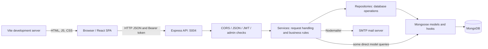
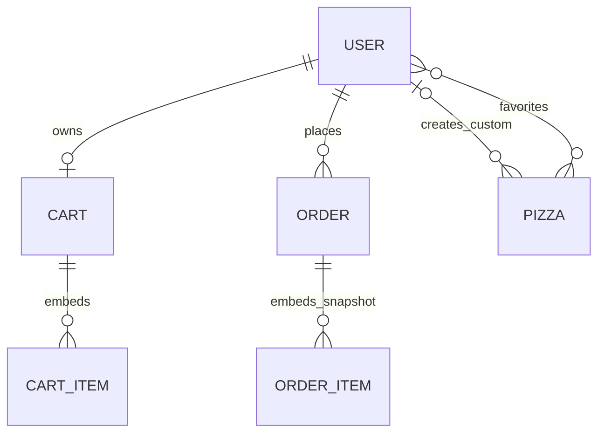

# Pizza Pete’s — Full-Stack Pizza Ordering Platform

A React and Express application that connects the customer pizza-ordering journey with restaurant administration. Customers can browse the menu, configure pizzas, save favorites and custom recipes, maintain a persistent cart, and place delivery or pickup orders. Administrators can manage users, edit the menu, and update order statuses.

The project demonstrates a JavaScript full-stack workflow: a browser-based single-page application, a JWT-authenticated REST API, a service/repository backend, MongoDB document models, and SMTP order notifications. It is useful for developers studying an end-to-end ordering application and for exploring a starting point for restaurant-specific workflows.

> **Project status:** Core workflows are implemented in source, but this is not a production-ready commerce system. Card payment is simulated, administrator provisioning is unrestricted, and several correctness and security issues remain. Use an isolated development database and read [Known limitations](#known-limitations-and-future-improvements) before running or exposing the application.

## Contents

- [Features](#features)
- [Screenshots and demonstrations](#screenshots-and-demonstrations)
- [Technology stack](#technology-stack)
- [Architecture](#architecture)
- [Project structure](#project-structure)
- [How the application works](#how-the-application-works)
- [Installation and local setup](#installation-and-local-setup)
- [Configuration reference](#configuration-reference)
- [Running and verifying the application](#running-and-verifying-the-application)
- [Usage guide](#usage-guide)
- [REST API reference](#rest-api-reference)
- [Database and data lifecycle](#database-and-data-lifecycle)
- [Testing and verification](#testing-and-verification)
- [Troubleshooting](#troubleshooting)
- [Build and deployment considerations](#build-and-deployment-considerations)
- [Known limitations and future improvements](#known-limitations-and-future-improvements)
- [Contributing](#contributing)
- [License](#license)
- [Author and repository](#author-and-repository)

## Features

### Customer workflows implemented in source

| Capability | Implementation and practical purpose |
| --- | --- |
| Account registration and login | Customer registration collects identity and delivery details; login returns a JWT for authenticated API requests. |
| Profile management | Customers can edit their name and address and change their password by supplying their current password. Self-service changes to email and administrator status are rejected. |
| Menu discovery | Browse available pizzas, filter by category, and search by name. The API supports `classic`, `special`, `vegetarian`, `spicy`, and `custom` categories. |
| Pizza configuration | Choose small, medium, or large size; thin, pan, or stuffed crust; additional toppings; and quantity. The home-page builder limits topping selection to eight. |
| Favorites | Add, remove, toggle, list, and count favorites stored against the customer account. |
| Saved custom pizzas | Create named recipes, list them, edit or delete owned recipes, and add them to the cart. Custom recipes share the Pizza collection with menu entries. |
| Persistent cart | MongoDB stores one cart per user, including configuration, quantity, unit price, line price, and total. |
| Checkout | Place delivery or pickup orders from the server-side cart, with an address, payment-method selection, and optional notes. |
| Order management | View paginated orders, search/filter the order list, inspect details, reorder through the frontend, and cancel eligible orders. |
| Status tracking API | Retrieve stored status, a display progress indicator, and estimated time by order number. This is not GPS or real-time delivery tracking. |
| Email notifications | Nodemailer attempts confirmation and status-update emails when SMTP credentials are configured. |

### Administrator workflows implemented in source

- List, inspect, update, and delete users; view user/admin counts.
- Create, edit, and delete pizzas, including their availability and image URL.
- View paginated orders, filter by status, and update order status.
- Inspect saved custom pizzas through an administrator API.

**Not implemented as a real integration:** payment processing, refunds, courier tracking, email verification, password-reset flows, or inventory management. Suggested improvements are listed separately below.

## Screenshots and demonstrations

No application screenshots, GIFs, or verified hosted demo URL are included in the repository. The two JPEG files under `back/src/` are not documented application screenshots and are not presented as demonstrations here. Architecture and checkout diagrams below describe the actual source flow.

The UI and API messages are predominantly French. Customer-facing prices are generally displayed in Tunisian dinars (`DT`), although some validation messages still refer to euros.

## Technology stack

Versions below are the dependency ranges declared in the package manifests; `package-lock.json` files pin the installed dependency trees.

| Layer | Technology | Role |
| --- | --- | --- |
| Frontend | React / React DOM `^19.1.1` | Functional page components, local state, effects, and rendering. |
| Navigation | React Router DOM `^7.9.4` | Browser-based routing and customer/admin page redirects. |
| HTTP client | Axios `^1.13.2` and browser Fetch | Requests from individual pages to the Express API. |
| Frontend tooling | Vite `^7.1.7`, React plugin `^5.0.4` | Development server and production asset build. |
| Code checks | ESLint `^9.36.0`, React Hooks/Refresh plugins | Frontend static analysis; existing findings remain. |
| Backend | Node.js, Express `^4.22.1` | CommonJS API server, routers, middleware, and JSON responses. |
| Persistence | MongoDB, Mongoose `^7.8.8` | Document storage, validation, references, indexes, and model hooks. |
| Authentication | JSON Web Token `^9.0.2`, bcryptjs `^2.4.3` | Bearer-token authentication and password hashing/comparison. |
| Validation | Joi `^17.13.3` | Request validation on authentication and order-placement routes. |
| Email | Nodemailer `^7.0.11` | SMTP confirmation and status-update messages. |
| Configuration | dotenv `^16.6.1`, cors `^2.8.5` | Backend `.env` loading and cross-origin request middleware. |
| Development | nodemon `^2.0.22` | Backend restart-on-change script. |

`bcrypt` and the native `mongodb` driver are also declared backend dependencies. Application password code uses `bcryptjs`, and persistence uses Mongoose; these additional packages do not imply separate implemented subsystems.

## Architecture

The repository contains **two independently installed applications**, not a workspace-managed monorepo. Vite serves the frontend; Express serves the API. Express does not serve the frontend build.



- **Frontend:** `front/src/main.jsx` mounts `App` in React Strict Mode. `App.jsx` defines routes. Page components contain UI, request logic, and extensive embedded styling; there is no central API client or global authentication provider.
- **API entry point:** `back/src/main.js` installs middleware and routers, connects to MongoDB, attempts initial seeding, then starts listening.
- **Routers:** map HTTP paths to singleton service methods. Authentication and administrator checks are applied at the route or router level.
- **Services:** act as both controllers and business-logic handlers: they inspect requests, apply checks, call repositories, and build responses. Some services also query Mongoose directly.
- **Repositories:** encapsulate most persistence operations, including cart merging, pagination, and population of user/favorite references.
- **Models:** `model.js` defines all four models, password hashing, cart total recalculation, and order-number/time generation.
- **Email:** SMTP calls run inside order requests. Failures are logged and return `false`; they do not roll back the order.

## Project structure

```text
.
├── README.md
├── back/
│   ├── .gitignore                 # Ignores backend .env, dependencies, logs, data
│   ├── package.json               # start and nodemon dev scripts
│   ├── package-lock.json
│   └── src/
│       ├── main.js                # Express setup, route mounting, connection, seed
│       ├── model.js               # User, Pizza, Cart, Order schemas and hooks
│       ├── schema.js              # Joi schemas and validateRequest middleware
│       ├── config/
│       │   ├── jwt.js             # JWT signing/verification; 30-day lifetime
│       │   └── db.js              # Connection helper; main.js connects directly
│       ├── middleware/
│       │   ├── auth.js            # Bearer authentication and isAdmin enforcement
│       │   └── customIdHandler.js # Normalizes temporary/custom cart pizza IDs
│       ├── router/                # Auth, user, pizza, custom pizza, cart, order,
│       │                          # administrator user and order routes
│       ├── service/               # HTTP handlers, business rules, email templates
│       ├── repository/            # Mongoose queries and persistence operations
│       └── *.jpg                 # Two image files; no static-serving middleware
└── front/
    ├── README.md                  # Original Vite/React template documentation
    ├── package.json               # dev, build, lint, preview scripts
    ├── package-lock.json
    ├── index.html                 # Root HTML and module entry
    ├── vite.config.js             # React plugin; no API proxy or env-based API URL
    ├── eslint.config.js           # Browser JS/JSX and React lint rules
    ├── public/vite.svg            # Template public asset
    └── src/
        ├── main.jsx               # createRoot and StrictMode
        ├── App.jsx                # BrowserRouter and access redirects
        ├── App.css                # Existing stylesheet
        ├── index.css              # Imported global styles
        └── pages/
            ├── Register.jsx       # Customer signup
            ├── Login.jsx          # Login and localStorage session persistence
            ├── Home.jsx           # Menu, favorites, pizza builder, custom saving
            ├── Profile.jsx        # Profile and password editing
            ├── MyCustomPizzas.jsx # Saved recipe management
            ├── Cart.jsx           # Cart, checkout, simulated card UI
            ├── OrderConfirmation.jsx # Route/localStorage-based confirmation
            ├── Orders.jsx         # Order list, details, cancellation, reorder
            ├── Admin.jsx          # User administration and user statistics
            ├── AdminPizzas.jsx    # Menu administration
            └── AdminOrders.jsx    # Order administration
```

## How the application works

### Startup and authentication

1. Running the backend loads `back/.env` through dotenv when started from `back/`.
2. Express enables unrestricted CORS, JSON parsing, request logging, and the API routers.
3. `startServer()` connects using `MONGODB_URI`, attempts seeding, and only then opens the HTTP port. A connection failure terminates the process; a seed failure is logged but does not stop startup.
4. Customer registration passes through Joi validation. The service checks for an existing email, creates a non-admin user, and returns user data and a token.
5. The User save hook hashes new passwords with bcryptjs and a cost factor of 12. Login compares the supplied password with that hash.
6. `generateToken()` signs `{ userId }` using `JWT_SECRET`, with a 30-day expiration.
7. The login page stores `token` and `user` in `localStorage`. The registration page instead redirects to login after successful signup.
8. Protected API requests send `Authorization: Bearer <token>`. Middleware verifies the token and loads the current User document. Admin checks use the database-backed `isAdmin` flag, not the browser's cached user object.

Client-side route redirects are a navigation convenience, not an authorization boundary. API middleware performs the actual access checks. There is no refresh-token or token-revocation mechanism.

### Configuration, cart pricing, and checkout

The home-page builder calculates:

```text
line total = (pizza base price + size surcharge + crust surcharge + toppings) × quantity
```

For example, the seeded Margherita base price is `10`; medium size adds `4`, thin crust adds `0`, and mushrooms add `1`. Two pizzas produce a submitted line price of `30`.

**Important:** this calculation happens in the browser. `CartService.addToCart()` accepts the submitted nonnegative `totalPrice` and derives `unitPrice = totalPrice / quantity`; it does not independently reconstruct the price from trusted catalog options.

The cart repository merges lines with matching pizza ID, size, crust, and toppings, preserving the existing line's unit price. Saving a cart recalculates its total as the sum of line prices. Quantity changes use the stored unit price rather than repeatedly multiplying an already-expanded line total.

```mermaid
sequenceDiagram
    actor Customer
    participant UI as React pages
    participant API as Express / services
    participant DB as MongoDB
    participant Mail as SMTP

    Customer->>UI: Configure pizza and add to cart
    UI->>API: POST /api/cart/add + JWT + configuration/price
    API->>DB: Find/create cart, merge or append line, save total
    DB-->>UI: Cart response via API
    Customer->>UI: Choose address, delivery/pickup, payment method
    UI->>API: POST /api/orders/place + JWT
    API->>API: Joi validation; strip unknown body fields
    API->>DB: Read persisted cart
    API->>API: Compute delivery fee and final total
    API->>DB: Save order snapshot
    API->>DB: Clear cart (separate write)
    API->>Mail: Attempt confirmation email
    Mail-->>API: Success or caught/logged failure
    API-->>UI: Order ID, number, totals, estimate, items
    UI-->>Customer: Confirmation page
```

Checkout uses the **persisted cart**, not the frontend's submitted `items`, `subtotal`, or `total`. Joi strips those unknown checkout fields. Current rules in `orderService.js` are:

- Delivery costs `3.500` when subtotal is **30 or less**; it is free only when subtotal is **greater than 30**.
- Pickup has no delivery fee, but an address is still required by validation and the model.
- No tax is added. `tva` appears in service code but is not a declared Order schema field, so clients should not rely on it being persisted or returned.
- Cash orders start with `paymentStatus: pending`; choosing card immediately sets `paymentStatus: paid` without charging a payment provider.
- New orders start as `pending`, with an estimated delivery time approximately 45 minutes after creation.
- Order creation and cart clearing are separate operations without a transaction or idempotency key.

The confirmation screen uses router state or cached `lastOrder` data, and contains a demo fallback. Treat the database-backed order API, not that screen alone, as proof of an order.

### Status updates

Administrators can set `pending`, `confirmed`, `preparing`, `out_for_delivery`, `delivered`, or `cancelled`. The API validates membership in that list but does not enforce a transition state machine. Delivery updates set `deliveredAt` and attempt an email. Customers may cancel their own orders unless the current status is `delivered`, `cancelled`, or `out_for_delivery`—cancellation is not limited to `pending` despite the route comment.

## Installation and local setup

### Prerequisites

- **Node.js:** Vite's installed package declares `^20.19.0 || >=22.12.0`. Node.js **22.12 or newer in the 22.x line** is a suitable choice; verification here used Node.js 22.22.3.
- **npm:** required for the supplied scripts and lockfiles; verification used npm 10.9.8. No repository-level npm version pin is supplied.
- **MongoDB:** a running local server or reachable MongoDB deployment. The repository does not pin or verify a MongoDB server version.
- **Git** to clone the source.
- **Optional SMTP account/server** for email delivery. Ordering can persist without working SMTP, but sending attempts can delay responses before failing.

There is no Docker Compose file, database migration framework, or root-level install/start script.

### 1. Clone and install both applications

```bash
git clone https://github.com/Achref-004/Full-Stack-Pizza-Ordering-Platform.git
cd Full-Stack-Pizza-Ordering-Platform

(cd back && npm ci)
(cd front && npm ci)
```

Use the two committed lockfiles for reproducible installation. Run subsequent backend commands from `back/` so dotenv reads the intended file.

### 2. Create backend configuration

The repository does not include a `.env.example`. The following is a safe example template for a new **`back/.env`**; replace the JWT placeholder before using authentication:

```dotenv
# Local development only; use a dedicated development database.
MONGODB_URI=mongodb://127.0.0.1:27017/pizzapetes
PORT=5004
JWT_SECRET=replace_with_a_long_random_value

# Optional email configuration. These blank values do not disable send attempts.
SMTP_HOST=smtp.gmail.com
SMTP_PORT=587
SMTP_USER=
SMTP_PASS=
```

Generate a random signing secret locally:

```bash
node -e "console.log(require('node:crypto').randomBytes(48).toString('hex'))"
```

Paste that value into `JWT_SECRET`. Never commit the generated secret or real SMTP credentials. `back/.gitignore` already excludes `back/.env`.

### 3. Prepare MongoDB and understand automatic initialization

Start MongoDB using the service or tools appropriate to your installation, then ensure the URI points to a development database. If `mongosh` is installed, check connectivity:

```bash
mongosh 'mongodb://127.0.0.1:27017/pizzapetes' --eval 'db.runCommand({ ping: 1 })'
```

No manual collection creation or migration command is required by this application. Mongoose models define collections and indexes; data is initialized on backend startup:

- If the **entire Pizza collection** is empty, six pizzas are inserted: Margherita, Pepperoni, Végétarienne, Quatre Fromages, Hawaïenne, and Reine.
- Seeded popularity and order counts are demonstration values, not evidence of real orders.
- If no administrator exists, a default administrator is automatically created with hardcoded credentials. For isolated local exploration, its credentials are present in `back/src/main.js` and printed by the startup routine; they are intentionally not repeated here.
- Seeding is conditional, not a database reset. Existing data is not replaced, and an existing custom pizza also prevents the empty-collection menu seed.

**Do not expose this default admin to a network.** There is no environment flag to disable its creation. Removing all admins causes the next startup to recreate it. Harden provisioning and remove credential logging before any shared deployment.

## Configuration reference

| Variable | Required? | Default / behavior |
| --- | --- | --- |
| `MONGODB_URI` | Optional override; a working database is required | `mongodb://localhost:27017/pizzapetes` in `main.js`. Using `127.0.0.1` explicitly can avoid localhost IPv6 resolution issues. |
| `PORT` | Optional | `5004`. Keep this port for the unmodified browser client. |
| `JWT_SECRET` | Required for authentication | No fallback. Used for signing and verifying 30-day JWTs. |
| `SMTP_HOST` | Optional | `smtp.gmail.com`. |
| `SMTP_PORT` | Optional | `587`; transport is configured with `secure: false`, not implicit TLS. |
| `SMTP_USER` | Required for configured authenticated SMTP | SMTP username and the email sender address. |
| `SMTP_PASS` | Required for configured authenticated SMTP | Provider-appropriate SMTP credential, such as an app password where required. |

**Frontend configuration:** API-calling pages hardcode `http://localhost:5004`. There is no implemented `VITE_API_URL` variable and no Vite proxy. Creating a frontend `.env` does not change that address. API calls use the browser's network context, so this setup assumes the browser, API, and development environment are on the same machine. Remote previews and production hosting need application/configuration changes first.

**Development versus production:** the current code does not provide separate deployment profiles, origin allowlists, seed-disable settings, or SMTP-disable settings. `npm start` removes nodemon from the backend launch path but does not automatically harden the application.

## Running and verifying the application

Start components in this order: **MongoDB → backend → frontend**.

### Terminal 1 — backend

From the repository root:

```bash
cd back
npm run dev
```

For a non-watching process, use `npm start` instead. The server should report a successful MongoDB connection and listen on port `5004`.

### Terminal 2 — frontend

From the repository root:

```bash
cd front
npm run dev
```

Open the URL Vite prints, normally **http://localhost:5173**. Port availability can cause Vite to select another port.

### Verify the API

```bash
curl -i http://localhost:5004/
curl -i http://localhost:5004/api/pizzas
```

The root response includes `status: "OK"` and version `1.0.0`. The pizza response contains `success`, `count`, and `pizzas`. The root endpoint is an informational route, not a database health probe; its embedded endpoint list also contains discrepancies described in the API reference.

## Usage guide

### Customer journey

1. Visit `/register`, enter your name, email, address, city, state, and a password of at least six characters.
2. Sign in at `/login`; customer accounts are directed to `/home`.
3. Browse pizzas, search/filter the menu, or select favorites.
4. Open a pizza configuration, choose size/crust/toppings and quantity, then add it to the cart. Save a named custom recipe if desired; manage saved recipes at `/my-custom-pizzas`.
5. Visit `/cart` to adjust quantities or remove items. Enter checkout details and select delivery or pickup.
6. For development, use **cash** to exercise checkout without the simulated card form. Never enter real card information.
7. After checkout, verify the order in `/orders`. From there, inspect details, reorder, or cancel an eligible order.
8. Use `/profile` for delivery-profile changes or password updates; log out to remove the browser session values.

### Administrator journey

An administrator login redirects to `/admin`. Use `/admin/pizzas` to maintain the menu and `/admin/orders` to review orders and change their status. The default administrator is for isolated local exploration only. Public administrator registration is currently possible through the API and must be restricted before deployment.

## REST API reference

Base URL for the unmodified local client: **`http://localhost:5004`**.

- **Public:** no JWT required.
- **User:** `Authorization: Bearer <token>` required.
- **Admin:** valid JWT and database user with `isAdmin: true` required.
- Most responses contain `success`; lists commonly add `count` or `pagination`. Payloads are endpoint-specific, not a single shared schema.
- Common statuses include `400` for invalid input, `401` for missing/invalid tokens, `403` for denied access, `404` for missing resources, `409` for duplicate account emails, and `500` for caught server errors. Some malformed IDs produce endpoint-specific `500` responses rather than uniform `400`s.

### Authentication and profile

| Method | Path | Access | Input / result |
| --- | --- | --- | --- |
| POST | `/api/auth/register` | Public | `firstName`, `lastName`, `email`, `address`, `city`, `state`, `password`; returns user and token, status 201. |
| POST | `/api/auth/login` | Public | `email`, `password`; returns user and token. |
| POST | `/api/auth/register-admin` | **Public; unsafe for deployment** | `email`, `password`; optional profile fields. Creates an administrator without an invitation or existing-admin check. |
| GET | `/api/user/profile` | User | Current profile, timestamps, and favorites count. |
| PUT | `/api/user/profile` | User | Name/address fields; optional `currentPassword` and `newPassword`. Email and role changes are forbidden. |

### Menu and saved custom pizzas

| Method | Path | Access | Input / result |
| --- | --- | --- | --- |
| GET | `/api/pizzas` | Public | All available pizzas, including available custom recipes. |
| GET | `/api/pizzas/search?query=margherita` | Public | Required `query`; case-insensitive name regex search. |
| GET | `/api/pizzas/category/:category` | Public | Available pizzas in the specified category. |
| GET | `/api/pizzas/:id` | Public | Pizza by MongoDB ObjectId. |
| POST | `/api/pizzas` | Admin | Pizza fields: name, description, basePrice, category, ingredients, imageUrl, isAvailable. |
| PUT / DELETE | `/api/pizzas/:id` | Admin | Update fields / delete pizza. |
| GET | `/api/pizzas/stats/all` | Admin | Menu statistics; availability caveat below. |
| POST | `/api/custom-pizzas/create` or `/api/custom-pizzas` | User | `name`, `description`, `basePrice`, optional `ingredients`/`category`, and `config: {size, crust, toppings}`. |
| GET | `/api/custom-pizzas/my-pizzas` | User | Owned, available custom recipes. |
| GET / PUT / DELETE | `/api/custom-pizzas/:id` | User/owner | Accepts ObjectId or generated `custom_...` identifier. Updates pass model fields through; stored configuration is `customConfig`. |
| POST | `/api/custom-pizzas/duplicate/:pizzaId` | User | Duplicate an original ObjectId with customizations. Supply valid `customConfig.size` and `customConfig.crust` for the custom model. |
| GET | `/api/custom-pizzas/admin/all` | Admin | All saved custom pizzas, with creator information. |
| GET | `/api/custom-pizzas/popular` | **Shadowed route** | Declared public, but earlier `GET /:id` captures `popular` and applies authentication/owner lookup. Not a working public popularity endpoint. |

### Favorites and cart

All routes in this table require a user JWT.

| Method | Path | Input / result |
| --- | --- | --- |
| GET | `/api/user/favorites` | Favorite pizzas with details. |
| GET | `/api/user/favorites/ids` | Favorite identifiers. |
| POST / DELETE | `/api/user/favorites/:pizzaId` | Add/remove a favorite by Pizza ObjectId. |
| GET | `/api/user/favorites/check/:pizzaId` | Whether the pizza is a favorite. |
| POST | `/api/user/favorites/toggle/:pizzaId` | Toggle favorite membership. |
| DELETE | `/api/user/favorites` | Clear favorite list. |
| GET | `/api/user/favorites/count` | Favorite count. |
| GET | `/api/user/popular` | Available pizzas ranked by stored popularity and order counts. |
| GET | `/api/cart` | Cart lines, total, quantity-based item count, and update time. |
| POST | `/api/cart/add` | `pizzaId`, `pizzaName`, `config: {size, crust, toppings, quantity}`, `totalPrice`; optional `isCustom`, `customDescription`. |
| PUT | `/api/cart/item/:itemId/quantity` | `{ "quantity": 2 }`; expected range 1–10. Use cart line ID, not pizza ID. |
| DELETE | `/api/cart/item/:itemId` | Remove a line. |
| DELETE | `/api/cart/clear` | Empty current user's cart. |
| GET | `/api/cart/count` | Quantity-based item count. |
| GET | `/api/cart/total` | Calculated cart total response. |
| POST | `/api/cart/fix-prices` | Existing cart price-repair helper, not a trusted catalog repricing mechanism. |

### Orders and administration

| Method | Path | Access | Input / result |
| --- | --- | --- | --- |
| POST | `/api/orders/place` | User | Required `deliveryAddress: {address, city, state}`; optional `deliveryMethod` (`delivery`/`pickup`), `paymentMethod` (`cash`/`card`), `notes` (up to 500 characters). |
| GET | `/api/orders/my-orders` | User | Query: `page` (default 1), `limit` (default 10), `status`, `search` (order number or pizza name); returns orders and pagination. |
| GET | `/api/orders/:id` | Owner or admin | Order details by MongoDB ID. There is **no** `/:id/details` route despite the root endpoint's listing. |
| PUT | `/api/orders/:id/cancel` | Owner | Cancel unless already delivered, cancelled, or out for delivery. |
| GET | `/api/orders/track/:orderNumber` | Owner or admin | Stored status, display progress, estimated time, items, and totals. |
| GET | `/api/orders/history` | **Shadowed route** | Earlier `GET /:id` captures `history`. Use `/my-orders` for the implemented frontend order-list workflow. |
| GET | `/api/admin/users` | Admin | All users, newest first; passwords excluded. |
| GET | `/api/admin/users/:id` | Admin | Specific user. |
| PUT / DELETE | `/api/admin/users/:id` | Admin | Update user fields (password changes blocked here) / delete user. |
| GET | `/api/admin/stats` | Admin | `totalUsers`, `totalAdmins`, `totalRegularUsers`. |
| GET | `/api/admin/orders` | Admin | Query: `page` (default 1), `limit` (default 20), `status`; returns orders and pagination. |
| PUT | `/api/admin/orders/:id/status` | Admin | `{ "status": "preparing" }`; supported statuses listed above. |

### Example: register, authenticate, add a pizza, and order

These shell examples use a local development account, not a seeded password. The request shapes are source-verified; the database-backed workflow was not executed during documentation verification.

```bash
curl -i -X POST http://localhost:5004/api/auth/register \
  -H 'Content-Type: application/json' \
  -d '{
    "firstName": "Demo",
    "lastName": "Customer",
    "email": "demo.customer@example.com",
    "address": "10 Example Street",
    "city": "Hammamet",
    "state": "Nabeul",
    "password": "local-demo-only-4829"
  }'

curl -sS -X POST http://localhost:5004/api/auth/login \
  -H 'Content-Type: application/json' \
  -d '{"email":"demo.customer@example.com","password":"local-demo-only-4829"}'
```

A successful login has this shape (placeholders stand for runtime values):

```json
{
  "success": true,
  "message": "Connexion réussie ! 🎉",
  "user": {
    "id": "<user-object-id>",
    "firstName": "Demo",
    "lastName": "Customer",
    "email": "demo.customer@example.com",
    "address": "10 Example Street",
    "city": "Hammamet",
    "state": "Nabeul",
    "isAdmin": false
  },
  "token": "<signed-jwt>"
}
```

Copy the token and a pizza `id` from `GET /api/pizzas` into the following shell variables:

```bash
TOKEN='paste-returned-token-here'
PIZZA_ID='paste-a-pizza-id-here'

curl -sS http://localhost:5004/api/user/profile \
  -H "Authorization: Bearer $TOKEN"

# Example price for one seeded Margherita: 10 base + 4 medium, thin crust.
curl -sS -X POST http://localhost:5004/api/cart/add \
  -H "Authorization: Bearer $TOKEN" \
  -H 'Content-Type: application/json' \
  -d "{\"pizzaId\":\"$PIZZA_ID\",\"pizzaName\":\"Margherita\",\"config\":{\"size\":\"medium\",\"crust\":\"thin\",\"toppings\":[],\"quantity\":1},\"totalPrice\":14,\"isCustom\":false}"

curl -sS -X POST http://localhost:5004/api/orders/place \
  -H "Authorization: Bearer $TOKEN" \
  -H 'Content-Type: application/json' \
  -d '{
    "deliveryAddress": {
      "address": "10 Example Street",
      "city": "Hammamet",
      "state": "Nabeul"
    },
    "deliveryMethod": "delivery",
    "paymentMethod": "cash",
    "notes": "Please ring the doorbell."
  }'

curl -sS 'http://localhost:5004/api/orders/my-orders?page=1&limit=10' \
  -H "Authorization: Bearer $TOKEN"
```

Order placement returns `success`, `message`, and an `order` object containing `id`, `orderNumber`, `subtotal`, `deliveryFee`, `total`, `estimatedDeliveryTime`, `status`, and summarized `items`. For the single-line example above, the source rules yield subtotal `14`, delivery fee `3.5`, and total `17.5`, provided the cart was otherwise empty.

## Database and data lifecycle

All models live in [`back/src/model.js`](back/src/model.js). Mongoose's default pluralization maps them to `users`, `pizzas`, `carts`, and `orders`.

| Model | Main fields | Relationships and behavior |
| --- | --- | --- |
| User | Name, unique lowercase email, address/city/state, password hash, `isAdmin`, favorites, timestamps | Favorites reference Pizza ObjectIds. Customer profile fields are conditionally required for non-admins. Password is removed by `toJSON()`. |
| Pizza | Name, description, `basePrice`, ingredients, category, image URL, availability, popularity/order counts, custom fields, timestamps | Optional `createdBy` references User. `isCustom` recipes require size/crust in `customConfig`. `customPizzaId` has a sparse unique index. |
| Cart | Unique `user`, embedded items, total, update time | One cart per user. Each embedded item has its own ID, mixed-type pizza identifier, configuration, price, unit price, and custom metadata. Save hooks update totals/time. |
| Order | User, embedded item snapshot, subtotal/fee/total, delivery address/method, payment fields, status, notes, order number, estimated/delivered times, timestamps | Many orders per user. Unique generated number follows `PZ-YYYYMMDD-#####`. Item names/configuration/prices are copied from the cart. |



`CART_ITEM` and `ORDER_ITEM` in the diagram are embedded subdocuments, **not separate collections**. Their `pizzaId` fields are `Mixed` rather than enforced Pizza references: values can be ObjectIds, saved `custom_...` identifiers, or temporary custom IDs.

### Persistence details worth knowing

- Pizza defines a text index on name/description, but the current search endpoint uses a case-insensitive name regex, not MongoDB text search.
- Adding/removing individual favorites adjusts stored popularity; initial seed counts are artificial. Clearing all favorites does not decrement those counters, and checkout does not update pizza order counts.
- Order item snapshots preserve ordering details independently of later menu edits. Customer profile addresses and order delivery addresses are stored separately.
- Deleting users or pizzas does not cascade through carts, orders, or favorites. Dangling references can remain.
- The Order `findOneAndUpdate` hook generates a new order number and estimated time whenever they are absent from an update. Consequently, status updates can change the public tracking number and reset the estimate; stable tracking identifiers need correction.
- No migrations, backup/restore procedures, or data-retention policy are supplied.

## Testing and verification

There are **no committed automated test suites or `test` scripts** in either package. A successful build is not evidence that checkout or authorization is fully tested.

Available checks, from the repository root:

```bash
# Frontend compilation and static checks
(cd front && npm run build)
(cd front && npm run lint)

# Backend JavaScript syntax checks (POSIX shell)
find back/src -name '*.js' -exec node --check {} \;
```

### Verification performed for this README

Checked on **2026-10-18**, with Node.js **22.22.3** and npm **10.9.8**:

| Check | Observed result |
| --- | --- |
| `npm ci --no-audit --no-fund` in each package | Succeeded. No dependency security-audit claim is made. |
| Frontend `npm run build` | Succeeded; Vite warned about a minified JavaScript chunk exceeding 500 kB. |
| Frontend `npm run lint` | Failed with **23 errors and 10 warnings**: unused variables and effect dependency warnings. |
| `node --check` for every backend `.js` file | Succeeded. This checks syntax only. |
| Isolated Express smoke check without a database connection | `/` returned 200 with `status: OK`; unauthenticated `/api/cart` returned 401; unknown route returned 404. |
| Shadowed route check | Unauthenticated `/api/custom-pizzas/popular` returned 401, confirming it reaches the earlier protected `/:id` route. |
| MongoDB-backed signup/cart/checkout, SMTP, browser interactions | **Not verified:** no MongoDB server or SMTP credentials were available in the documentation workspace. |

The isolated smoke check imported the exported Express app and used a temporary listener; it did not execute normal MongoDB connection or seeding startup.

For a manual end-to-end check on your machine, use a fresh development database, register a customer, add/configure a pizza, change quantity, place a cash order, confirm the cart empties, retrieve the order, then update its status with an admin account. Check server logs and database records as well as the UI.

## Troubleshooting

| Symptom | Likely cause and practical action |
| --- | --- |
| Backend exits with MongoDB connection error | Start MongoDB and verify `MONGODB_URI`, credentials, and network access. Try `127.0.0.1` instead of `localhost` for a local server. |
| API never starts listening | Normal startup awaits MongoDB connection and seed attempt before listening. Inspect terminal output first. |
| Login/register errors after user creation | Check `JWT_SECRET` in `back/.env`. Token signing happens after saving a registration, so an invalid secret can leave an account created even when the response fails. Try login after fixing configuration rather than repeatedly registering. |
| Browser reports network/CORS errors | Verify the API is at `http://localhost:5004`. Backend CORS is permissive, but the hardcoded browser address, blocked mixed HTTP/HTTPS content, or a remote browser can still prevent access. |
| `401` after previously signing in | Token may be expired, invalid after a secret change, or refer to a deleted user. Sign out and sign in again. |
| `403` on admin requests | A valid customer JWT is not an administrator JWT. Confirm the account's database role; changing browser storage does not grant API access. |
| SMTP errors but order exists | Email errors are caught after order persistence and cart clearing. Check SMTP host/port/authentication; do not repeatedly submit checkout just to retry email. |
| `/api/orders/history` or `/api/custom-pizzas/popular` fails | These static paths are shadowed by earlier `/:id` routes. Use `/api/orders/my-orders` for the order list; route ordering requires a code fix. |
| `/api/orders/:id/details` gives 404 | Actual detail route is `/api/orders/:id`; the root informational listing is outdated. |
| Unavailable pizzas disappear from admin menu listing | Shared `findAll()` returns only `isAvailable: true`, including for admin listing/statistics. This needs a separate administrator query. |
| Tracking number changes after status update | Existing Order update hook regenerates it. Retrieve current order details; fixing stable identifiers requires a code change. |
| Confirmation screen shows unexpected data | It may use cached `lastOrder` or demo fallback rather than a new API read. Verify using `/orders` and order detail API. |
| `npm run lint` fails | Existing lint findings are documented above; do not interpret them as an installation error. |
| Missing background/menu imagery | UI uses external Unsplash/Wikimedia URLs in addition to stored image URLs. Restricted/offline networks may block them; backend JPEGs are not served as static assets. |
| `npm` command fails from repository root | There is no root `package.json`; run scripts from `front/` or `back/`. |

## Build and deployment considerations

The repository supplies build/start scripts, but **no validated hosting deployment, CI workflow, Dockerfile, reverse-proxy configuration, or infrastructure manifest**.

The frontend build command was verified:

```bash
cd front
npm run build
```

This generates `front/dist/` (ignored by Git). To inspect that build locally:

```bash
npm run preview
```

Use the URL printed by Vite and keep the backend running separately. Previewing static assets does not change the hardcoded API URL or provide a production server.

The backend entry command is:

```bash
cd back
npm start
```

Actual database-connected operation still depends on your MongoDB configuration. A public deployment requires additional work, not just running these commands:

1. Replace page-local localhost URLs with an environment-aware API client or a same-origin proxy design; configure SPA fallback routing for BrowserRouter.
2. Restrict/remove public administrator registration, replace default admin provisioning, and remove logged credentials/request bodies containing passwords.
3. Recalculate prices server-side, replace simulated payment with a provider-backed flow, and never collect real card data using this implementation.
4. Configure HTTPS, narrowly scoped CORS, secure secret injection, database access controls, rate limiting, and a reviewed browser session strategy.
5. Fix route ordering, update hooks, request-field allowlists, and identifier/reference handling; add integration tests before relying on workflows.
6. Add transaction/idempotency protections, reliable email delivery/retry handling, logs without sensitive data, monitoring, backups, and a deployment-specific runbook.

Hosting provider, domains, production database version, SMTP provider, and payment provider are not established in the repository. No provider-specific deployment instructions are claimed here.

## Known limitations and future improvements

### Established implementation limitations

- **Administrator provisioning:** unauthenticated administrator registration and automatic hardcoded admin creation are critical barriers to public use. Signup handlers log request bodies, including plaintext passwords; the seed routine prints its password.
- **Untrusted prices and simulated payments:** cart totals originate in the client. Card selection marks orders paid without an external transaction; no refund flow exists.
- **Validation is uneven:** Joi middleware is wired to auth and place-order routes, not every schema declared in `schema.js`. Other endpoints use manual checks/Mongoose validation; custom update and duplication handlers accept broad body fields rather than consistent allowlists.
- **Route shadowing:** `/api/orders/history` and `/api/custom-pizzas/popular` are captured by earlier dynamic routes. The history service also passes date filters that the user-order repository does not apply.
- **Order identifier mutation:** `findOneAndUpdate` regenerates order numbers and estimated times on status changes. The tracking `isLate` flag compares a value already clamped to zero, so it cannot report lateness correctly.
- **Menu visibility and statistics:** public menu queries include available custom recipes. The same available-only query is reused for admin listing/statistics, so unavailable counts and total-menu statistics are misleading.
- **Reference consistency:** cart/order pizza identifiers are Mixed rather than a single reference scheme; order-list code attempts population on that field. All ID variants and Mongoose population behavior need database-backed tests before reliable image/reference resolution can be assumed.
- **Data consistency:** no checkout transaction, idempotency protection, cascading deletions, or robust popularity-counter reconciliation is implemented.
- **Frontend coupling:** page-local URLs, localStorage sessions, large page components/embedded styles, cached/demo confirmation behavior, and outstanding lint issues increase maintenance and deployment work.
- **Commercial details:** currency wording is inconsistent; no currency field exists in the models. Email templates still contain tax-inclusive wording despite tax-free order calculations, plus unverified sample contact details.

### Suggested next steps — not implemented commitments

1. Add API integration tests and browser tests covering customer/admin authorization, both pizza ID formats, checkout, and cancellation.
2. Enforce trusted catalog pricing, field allowlists, and secure admin provisioning before external access.
3. Stabilize order numbers; define legal status transitions and durable payment events.
4. Centralize frontend API/auth state, introduce deployment configuration, and split large pages into reusable components.
5. Add checkout idempotency/transactions, background email jobs, consistent pagination validation, and reference cleanup.
6. Resolve lint findings, add CI, document a verified production deployment, and supply real screenshots.

## Contributing

No dedicated contribution policy or issue templates are included. To contribute:

1. Open an [issue](https://github.com/Achref-004/Full-Stack-Pizza-Ordering-Platform/issues) describing a bug or proposal. Include reproduction steps, expected/actual results, Node/npm versions, and sanitized logs. Never include `.env` contents, JWTs, customer details, or real payment information.
2. Keep changes focused and explain which frontend pages, API routes, or model behavior they affect.
3. Install each package with `npm ci`, run the documented build/lint/syntax checks, and describe manual or automated validation. Note existing lint findings separately from new ones.
4. Submit a pull request with setup/configuration impacts and screenshots for UI changes. Include test coverage for changed behavior where possible.

Security-sensitive reports should avoid publishing exploit details or secrets. No private security-reporting contact or `SECURITY.md` is supplied; maintainers should establish one before public production use.

## License

`back/package.json` declares **ISC**, but no repository-level `LICENSE` file is present and the frontend manifest does not specify a license. The scope and complete licensing terms for the whole repository therefore cannot be confirmed from the supplied files. Ask the maintainer to add an explicit repository-wide license before relying on reuse/distribution permissions.

## Author and repository

- **Repository owner:** [Achref-004](https://github.com/Achref-004)
- **Repository:** [Full-Stack-Pizza-Ordering-Platform](https://github.com/Achref-004/Full-Stack-Pizza-Ordering-Platform)
- The inspected Git commit metadata names **Achref Bejaoui**. No portfolio or verified project contact channel is provided; sample support details inside email templates are not treated as author contact information.

Maintainer clarification would help establish the intended repository-wide license, supported MongoDB version, production hosting target, real payment/email providers, and a private security contact. These are intentionally left unclaimed rather than inferred.
