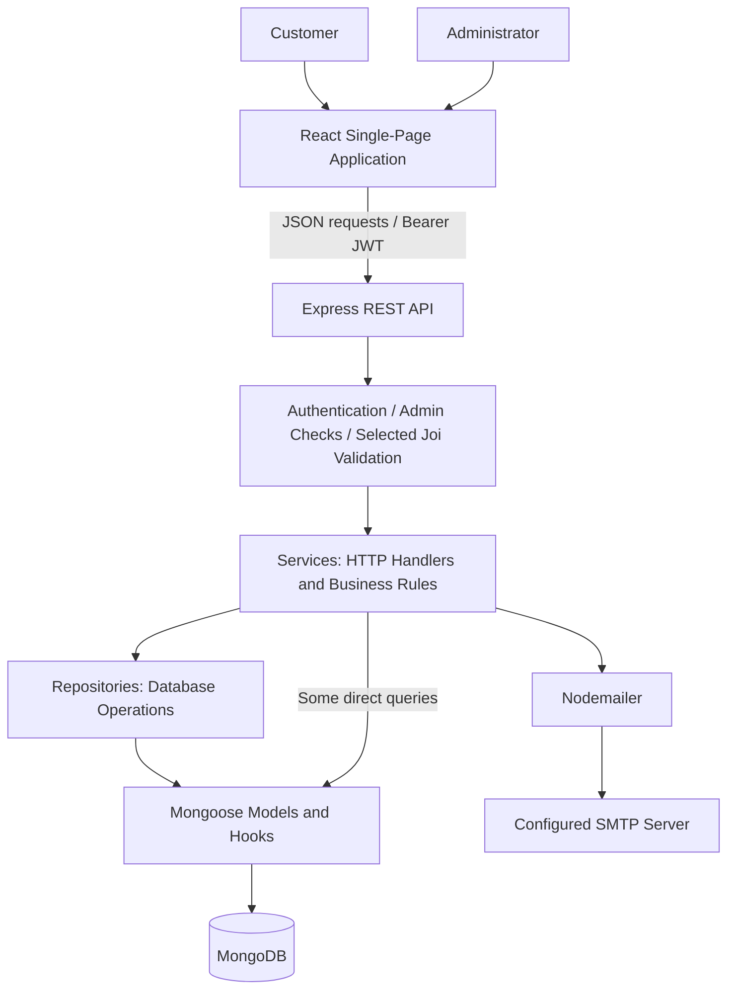
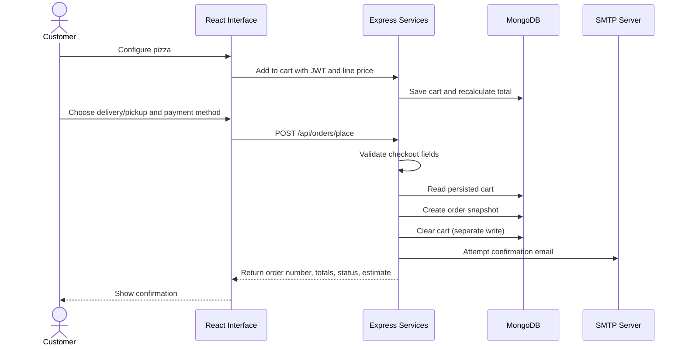
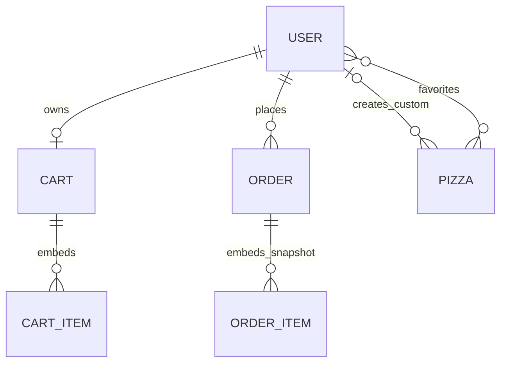

<p align="center">
  
</p>
<div align="center">

# 🍕 Pizza Pete’s

### Full-Stack Pizza Ordering Platform

**Pizza Customization · Persistent Cart · Customer Accounts · Order Management · Restaurant Administration**

[](#technology-stack)
[](#technology-stack)
[](#architecture)
[](#database)
[](#installation-and-run)
[](#1-customer-accounts-and-authentication)

**One application connecting the customer’s pizza order with the restaurant’s daily management workflow.**

[Overview](#overview) ·
[Architecture](#architecture) ·
[Core Modules](#core-modules) ·
[Showcase](#platform-showcase) ·
[Installation](#installation-and-run) ·
[Verification](#verification) ·


</div>

---

# Overview

**Pizza Pete’s is a full-stack JavaScript application for configuring pizzas, placing orders, and managing restaurant operations through separate customer and administrator interfaces.**

The application connects six functional areas:

1. customer accounts and authentication;
2. menu discovery and favorites;
3. pizza customization and saved recipes;
4. persistent cart and checkout;
5. customer order management;
6. restaurant administration and email notifications.

Rather than stopping at a menu interface, the project follows data from a customer's selection through API validation, MongoDB persistence, order creation, and administrator status updates.

```text
Customer Account
      │
      ▼
Menu & Favorites
      │
      ▼
Pizza Configuration ──► Saved Custom Recipes
      │
      ▼
Persistent Cart
      │
      ▼
Delivery / Pickup Order
      │
      ├──► Customer Order History
      ├──► Administrator Status Updates
      └──► SMTP Email Notifications
```


---

# Problem and Purpose

A pizza-ordering workflow involves more than choosing an item from a menu:

- customers need configurable sizes, crusts, toppings, and quantities;
- carts must persist between page visits;
- checkout needs an order snapshot and delivery details;
- customers need access to their previous orders;
- restaurant staff need tools to maintain the menu and update fulfillment status.

Pizza Pete’s brings these concerns into one application, while keeping the browser interface, HTTP API, business rules, and persistence code identifiable in the repository.


---

# Architecture



| Component | Responsibility |
|---|---|
| **React frontend** | Renders customer/admin pages, manages page state, and sends API requests. |
| **Express routers and middleware** | Map endpoints to handlers and enforce JWT/admin requirements. |
| **Services** | Handle requests, apply workflow checks, coordinate persistence, and produce JSON responses. |
| **Repositories** | Perform most queries, cart updates, pagination, and reference population. |
| **Mongoose models** | Define users, pizzas, carts, orders, indexes, validation, and save/update hooks. |
| **Email service** | Attempts order-confirmation and status-update messages through SMTP. |


---

# Core Modules

## 1. Customer Accounts and Authentication

Customer registration stores identity and delivery information. Passwords are hashed with **bcryptjs**, and login returns a **JWT with a 30-day expiration**.

```text
Register / Login
      ↓
Validate Input and Verify Credentials
      ↓
Return JWT + User Profile
      ↓
Browser localStorage
      ↓
Authorization: Bearer <token>
      ↓
API Loads Current User and Checks Access
```

The browser uses cached authentication data for page redirects; the API checks the actual database user for protected requests. Customers can edit their profile and change passwords using their current password. Email verification, password reset, refresh tokens, and token revocation are not implemented.


## 2. Menu Discovery and Favorites

Customers can browse available pizzas, search by name, filter categories, and maintain favorites tied to their account.

| Category | API value |
|---|---|
| Classic | `classic` |
| Special | `special` |
| Vegetarian | `vegetarian` |
| Spicy | `spicy` |
| Custom | `custom` |

Favorites are Pizza references stored on the User document. Public menu queries also include available custom pizzas; custom recipes are not a separate private catalog.


## 3. Pizza Customization and Saved Recipes

The home-page builder supports:

- **three sizes:** small, medium, large;
- **three crusts:** thin, pan, stuffed;
- additional toppings, with an eight-topping UI selection limit;
- quantities from one to ten;
- named custom recipes saved to the customer account.

```text
Base Pizza
    + Size Surcharge
    + Crust Surcharge
    + Selected Toppings
              ↓
       Multiply by Quantity
              ↓
        Submitted Line Price
```

Saved recipes use the same **Pizza model** as menu items, with `isCustom`, `createdBy`, `customConfig`, and a generated `customPizzaId`.


## 4. Persistent Cart and Checkout

MongoDB stores one cart per user. Cart lines contain the chosen configuration, quantity, unit price, and expanded line price. Matching configurations can merge into an existing line.

Checkout reads the **persisted server-side cart** rather than trusting frontend-submitted order totals.

| Rule | Current implementation |
|---|---|
| Delivery fee | `3.500` when subtotal is **30 or less**; free above `30`. |
| Pickup | No delivery fee; an address is still required. |
| Tax | No tax added by checkout. |
| Cash | Initial payment status is `pending`. |
| Card | Marked `paid` without a payment-provider transaction. |
| Order creation | Save an order snapshot, then clear the cart in a separate write. |


## 5. Customer Order Management

Customers can retrieve paginated orders, filter/search the list, inspect details, reorder from the interface, and cancel eligible orders.

Supported status values:

```text
pending → confirmed → preparing → out_for_delivery → delivered
    
    └── cancelled
```

This is an illustrative fulfillment path, **not an enforced state machine**: administrators can currently choose any supported status. Customers cannot cancel orders that are already delivered, cancelled, or out for delivery.

The tracking API returns the stored status and an estimated time. It does not provide GPS tracking or a live courier integration.


## 6. Restaurant Administration and Notifications

Administrator pages cover:

- listing, editing, and deleting users;
- customer/admin counts;
- creating, editing, and deleting pizzas;
- reviewing orders and changing their status.

Nodemailer attempts confirmation and status-update emails. SMTP failures are caught and logged; they do not undo a persisted order. Email delivery is attempted inside the request rather than through a background job queue.


---

# Platform Showcase


## Menu Categories and Favorites

<p align="center">
  
</p>

Category navigation and saved favorites keep frequently selected pizzas accessible from the customer interface.

---

## Pizza Configuration

<p align="center">
  
</p>

The configuration dialog exposes size and crust surcharges alongside additional toppings.

---

## Persistent Shopping Cart

<p align="center">
  
</p>

Customers can change quantities, remove items, inspect the delivery fee, and proceed to checkout.


---

## Restaurant Menu Management

<p align="center">
  
</p>

Administrators maintain menu data through dedicated forms. Image handling uses URLs; the repository does not implement a file-upload service.

---

# End-to-End Workflow




---

# Technology Stack

| Layer | Technologies | Purpose |
|---|---|---|
| Frontend | React 19, React DOM | Page rendering, local state, effects. |
| Navigation | React Router DOM 7 | Customer/admin routes and redirects. |
| HTTP | Axios, browser Fetch | JSON API requests. |
| Build tooling | Vite 7, React plugin | Development server and frontend production build. |
| Backend | Node.js, Express 4 | REST API and HTTP request handling. |
| Database | MongoDB, Mongoose 7 | Documents, references, validation, indexes, hooks. |
| Authentication | jsonwebtoken, bcryptjs | Bearer tokens and password hashing. |
| Validation | Joi | Authentication and checkout request schemas. |
| Notifications | Nodemailer | SMTP email attempts. |
| Configuration | dotenv, cors | Environment loading and cross-origin middleware. |
| Development checks | ESLint 9, nodemon | Frontend lint and backend reloads. |


---

# Repository Structure

```text
Full-Stack-Pizza-Ordering-Platform/
├── back/
│   ├── package.json             # start / dev scripts
│   ├── package-lock.json
│   └── src/
│       ├── main.js              # Express, MongoDB connection, automatic seed
│       ├── model.js             # User, Pizza, Cart, Order schemas and hooks
│       ├── schema.js            # Joi schemas and request validator
│       ├── config/              # JWT utilities and separate DB helper
│       ├── middleware/          # Authentication, admin checks, custom IDs
│       ├── router/              # HTTP route definitions
│       ├── service/             # Request handling, workflows, email templates
│       └── repository/          # Queries and persistence operations
├── front/
│   ├── package.json             # dev / build / lint / preview scripts
│   ├── package-lock.json
│   ├── vite.config.js           # React plugin; no API proxy
│   ├── public/                  # Supplied screenshots and public assets
│   └── src/
│       ├── main.jsx             # React entry point
│       ├── App.jsx              # BrowserRouter and access redirects
│       └── pages/               # Customer and administrator screens
└── README.md
```


---

# Database



| Model | Stored information |
|---|---|
| **User** | Profile, address, unique email, password hash, admin flag, favorite references. |
| **Pizza** | Menu details, base price, category, ingredients, availability, custom-recipe fields. |
| **Cart** | User reference, embedded configured lines, unit/line prices, total. |
| **Order** | Customer reference, item snapshots, delivery details, totals, status, payment labels, tracking number, timestamps. |

Cart and order items are embedded subdocuments, not separate collections. Their mixed-type pizza IDs support ObjectIds and custom identifiers rather than one enforced reference scheme.


---

# Installation and Run

## 1 / Install

**Requirements:** Node.js 22.12+ in the 22.x line, npm, Git, and a running MongoDB server. SMTP is optional for actual email delivery.

```bash
git clone https://github.com/Achref-004/Full-Stack-Pizza-Ordering-Platform.git
cd Full-Stack-Pizza-Ordering-Platform

(cd back && npm ci)
(cd front && npm ci)
```

## 2 / Configure

Create **`back/.env`** using this safe template. Generate a random secret before using authentication.

```dotenv
MONGODB_URI=mongodb://127.0.0.1:27017/pizzapetes
PORT=5004
JWT_SECRET=replace_with_a_long_random_value

# Optional SMTP credentials; blank values do not disable send attempts.
SMTP_HOST=smtp.gmail.com
SMTP_PORT=587
SMTP_USER=
SMTP_PASS=
```

```bash
# Generate a secret locally; paste it into JWT_SECRET. Never commit it.
node -e "console.log(require('node:crypto').randomBytes(48).toString('hex'))"
```


## 3 / Run

Start **MongoDB first**, then launch the two applications in separate terminals, from the repository root:

| Terminal A — API | Terminal B — frontend |
| :--- | :--- |
| `cd back` | `cd front` |
| `npm run dev` | `npm run dev` |
| `http://localhost:5004` | Usually `http://localhost:5173` |

```bash
# Check the API, then open the frontend URL printed by Vite.
curl -i http://localhost:5004/
curl -i http://localhost:5004/api/pizzas
```


---

# Usage and API Reference

### Customer journey

```text
/register → /login → /home → /cart → /confirmation → /orders
                         ├── /my-custom-pizzas
                         └── /profile
```


### Administrator journey

```text
Administrator login → /admin
                         ├── /admin/pizzas
                         └── /admin/orders
```

### Representative endpoints

| Method | Endpoint | Access / purpose |
|---|---|---|
| POST | `/api/auth/register` | Public customer registration. |
| POST | `/api/auth/login` | Return profile and JWT. |
| GET | `/api/pizzas` | Public list of available pizzas. |
| GET | `/api/user/profile` | Authenticated profile. |
| POST | `/api/cart/add` | Authenticated cart mutation. |
| POST | `/api/orders/place` | Create an order from the stored cart. |
| GET | `/api/orders/my-orders` | Customer orders with pagination/filtering. |
| GET | `/api/orders/:id` | Owner/admin order details. |
| PUT | `/api/admin/orders/:id/status` | Administrator status update. |

Protected requests use `Authorization: Bearer <token>`.


---


---


# Limitations

This project contains implemented workflows, but several boundaries matter when evaluating or extending it:


- **Order consistency:** saving orders and clearing carts are separate writes without a transaction or idempotency key.
- **Tracking identifiers:** the Order update hook can regenerate order numbers and estimated times on status changes.
- **Session and deployment configuration:** tokens use localStorage, and frontend API URLs are hardcoded to localhost.
- **Data integrity:** deletes do not cascade; mixed pizza IDs, population, and popularity counters need stronger integration coverage.
- **Quality checks:** there is no committed automated test suite, and frontend lint findings remain.


---

# Future Improvements

These are suggested extensions, not implemented capabilities or a committed roadmap.

### Security and Payments

- Controlled administrator provisioning and sensitive-log removal.
- Trusted server-side pricing and stricter request field allowlists.


### Ordering and Data Integrity

- Stable tracking numbers and explicit status-transition rules.
- Transactional/idempotent checkout.


### Engineering

- API integration tests and browser workflow tests.
- Centralized frontend API configuration and reusable UI components.


---


# Author

**Achref Bejaoui** 

[GitHub Profile](https://github.com/Achref-004) · [Project Repository](https://github.com/Achref-004/Full-Stack-Pizza-Ordering-Platform)


---

<div align="center">

### 🍕 From a configured pizza to a managed order.

**React interface. Express workflows. MongoDB persistence.**


</div>
